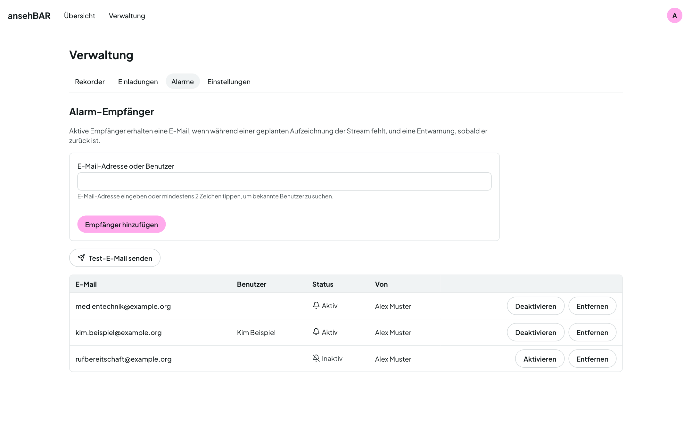

# Alarme

ansehBAR alarmiert nur während geplanter Opencast-Termine. Außerhalb von
Terminen ist „kein Stream“ normal und löst nichts aus. Alarme setzen deshalb
die Anbindung an Opencast voraus.

## Stream fehlt

- Fehlt der Stream zum Terminbeginn oder bricht er ab, entsteht ein
  **Vorfall**. Er wird immer protokolliert und erscheint in Zeitleiste und
  [Kalender](kalender.md).
- Ein **Alarm** geht raus, sobald der Stream länger fehlt, als der
  [Alarmmodus](rekorder.md#alarmmodus) des Raums erlaubt — etwa 3 Minuten
  nach dem Opencast-Start.
- **Entwarnung:** Läuft der Stream nach einem Alarm wieder mindestens eine
  Minute stabil, geht eine Entwarnung an dieselben Empfänger.
- Kurzes Flackern ist kein Ausfall. Fällt der Stream nach einer Entwarnung
  erneut aus, gibt es einen neuen Alarm.
- Endet der Stream kurz vor dem geplanten Ende, ist das kein Vorfall.

## Ton fehlt

- Der Monitor misst während laufender Termine den Pegel jedes Raums.
- Eine Stille ab 2 Minuten wird **protokolliert** (Pausen, Stillarbeit).
- Ein **Alarm** geht erst raus, wenn es durchgehend länger als 15 Minuten
  still ist — und nur einmal pro Termin.
- Kommt der Ton nach einem Alarm zurück, gibt es eine Entwarnung per E-Mail.

Schwelle und Zeiten stehen in den [Einstellungen](einstellungen.md#ton).

## Wer die Alarme bekommt

Unter **Verwaltung → Alarme** pflegen Sie die Empfänger:

- **Empfänger hinzufügen:** eine E-Mail-Adresse eintragen oder eine Person
  suchen, die sich schon einmal bei ansehBAR angemeldet hat.
- Jeder Empfänger lässt sich einzeln **aktivieren oder deaktivieren**, etwa
  für den Urlaub, und entfernen.
- **Test-E-Mail senden** schickt allen aktiven Empfängern eine Probemail.

Eine Alarm-E-Mail enthält alles zum Weiterleiten: Raum, Rekorder, Art des
Problems, Termin mit Titel und geplanter Zeit, seit wann, und einen Link zur
Raumansicht.

## Monitoring-Dienst

Zusätzlich kann ansehBAR seine Alarme an einen Monitoring-Dienst geben
(Prometheus mit Alertmanager). Der Dienst fragt ansehBAR regelmäßig ab und
verteilt die Alarme selbst, etwa in einen Chat-Raum. Über diesen Weg gibt es
keine Entwarnungen. Die Einrichtung beschreibt die
[Installation](../installation.md).

Beide Kanäle lassen sich in den [Einstellungen](einstellungen.md#alarme)
einzeln abschalten.
