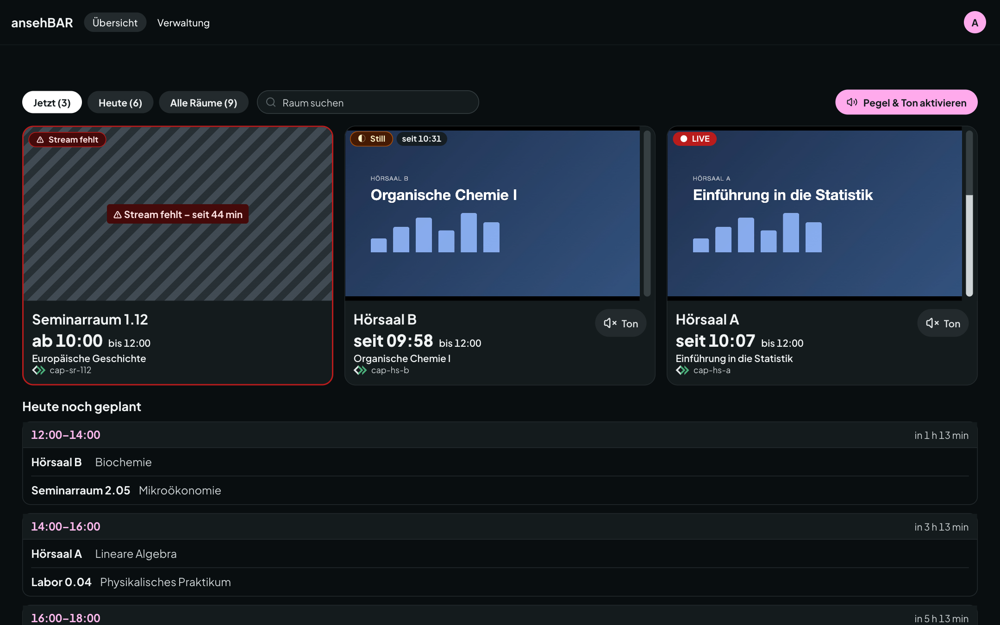

# Anmelden

ansehBAR ist ein Werkzeug für einen kleinen Personenkreis, etwa Medientechnik
und das Team Aufzeichnungen. Die Streams sind kein öffentliches Angebot.

## So melden Sie sich an

1. ansehBAR im Browser öffnen und **Anmelden** wählen.
2. Mit dem Konto Ihrer Einrichtung anmelden. ansehBAR nutzt den Identity
   Provider der Einrichtung (OIDC, z. B. Keycloak); ein eigenes Passwort gibt
   es nicht.
3. Danach öffnet sich die [Übersicht](uebersicht.md).

## Wer Zugang hat

Zugang hat, wer mindestens eine dieser Bedingungen erfüllt:

- **Gruppe:** Sie gehören zur ansehBAR-Gruppe im Identity Provider. Die
  Gruppenzugehörigkeit wird bei jeder Anmeldung neu gelesen; wer aus der
  Gruppe entfernt wird, verliert den Zugang mit der nächsten Anmeldung.
- **Einladung:** Jemand mit Zugang hat Sie unter
  [Verwaltung → Einladungen](zugang.md) mit Ihrem Benutzernamen oder Ihrer
  E-Mail-Adresse eingeladen.
- **Ersteinrichtung:** Bei der Installation trägt der Betrieb einzelne Konten
  fest ein, damit die ersten Personen hineinkommen.

Melden Sie sich an, ohne Zugang zu haben, zeigt ansehBAR eine Seite mit dem
Hinweis, an wen Sie sich wenden können.

## Sprache und Design

Im Menü oben rechts stellen Sie die Sprache (Deutsch oder Englisch) und das
Design (hell, dunkel oder wie das System) ein.

