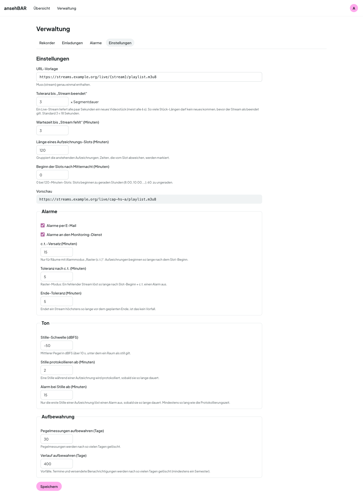

# Einstellungen

Unter **Verwaltung → Einstellungen** stehen die Werte, die für alle Räume
gelten. Jedes Feld erklärt sich mit einem kurzen Hinweis; **Speichern**
übernimmt alles auf einmal.

## Stream

| Einstellung | Bedeutung | Standard |
|---|---|---|
| URL-Vorlage | Adresse der Streams; `{stream}` wird durch den Stream-Namen ersetzt. Die Vorschau zeigt das Ergebnis. | — |
| Toleranz bis „Stream beendet“ | So viele Segmentlängen darf kein neues Videostück kommen, bevor ein Stream als beendet gilt. | 3 |
| Wartezeit bis „Stream fehlt“ | Minuten nach dem Terminbeginn, bevor ein fehlender Stream zählt | 3 |
| Länge eines Aufzeichnungs-Slots | gruppiert „Heute noch geplant“; Zeiten, die vom Slot abweichen, werden markiert | 120 |
| Beginn der Slots nach Mitternacht | 0 bei 120 Minuten: Slots beginnen zu geraden Stunden | 0 |

## Alarme

| Einstellung | Bedeutung | Standard |
|---|---|---|
| Alarme per E-Mail | Kanal an oder aus | an |
| Alarme an den Monitoring-Dienst | Kanal an oder aus | an |
| c.t.-Versatz | nur für Räume im Modus „Raster (c.t.)“: Aufzeichnungen beginnen so lange nach dem Slot-Beginn | 15 |
| Toleranz nach c.t. | im Raster-Modus: so lange nach Slot-Beginn + c.t. löst ein fehlender Stream Alarm aus | 5 |
| Ende-Toleranz | endet ein Stream höchstens so lange vor dem geplanten Ende, ist das kein Vorfall | 5 |

## Ton

| Einstellung | Bedeutung | Standard |
|---|---|---|
| Stille-Schwelle (dBFS) | mittlerer Pegel über 10 s, unter dem ein Raum als still gilt | −50 |
| Stille protokollieren ab | Minuten, ab denen eine Stille protokolliert wird | 2 |
| Alarm bei Stille ab | Minuten durchgehender Stille bis zum Alarm (nur einmal pro Termin) | 15 |

**Schwelle einstellen:** Öffnen Sie in der [Raumansicht](raumansicht.md#pegelkurve)
oder im [Kalender](kalender.md#tag) die Pegelkurve einiger Vorlesungen.
Liegt der Vortrag z. B. bei −25 dBFS und eine Pause bei −60 dBFS, passt eine
Schwelle dazwischen.

## Aufbewahrung

| Einstellung | Bedeutung | Standard |
|---|---|---|
| Pegelmessungen aufbewahren | Tage, die die einzelnen Messungen (Grundlage der Pegelkurve) bleiben | 30 |
| Verlauf aufbewahren | Tage, die Termine, Vorfälle und versendete Benachrichtigungen bleiben; mindestens ein Semester (183) | 400 |

Ältere Daten löscht der Monitor einmal pro Stunde.
