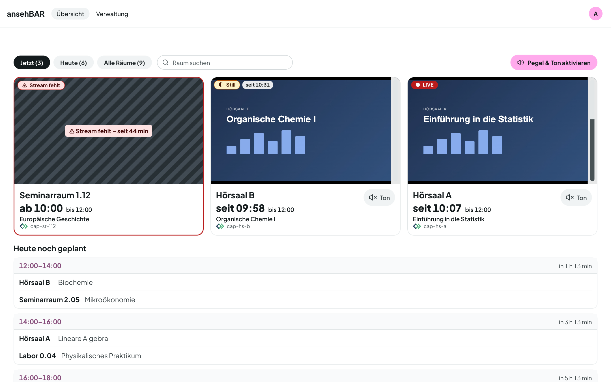

# Anleitung

ansehBAR zeigt, welche Aufzeichnungsräume gerade live streamen, und prüft Bild
und Ton. Mit Anbindung an Opencast weiß ansehBAR außerdem, wann in welchem Raum
eine Aufzeichnung geplant ist. Dann zeigt es auch, wo ein Stream **fehlt**, und
schickt Alarme.

Die Rekorder streamen während jeder Aufzeichnung live: Kamera- und
Bildschirmbild in einem Video. Fehlt der Live-Stream, ist meist auch die
Aufzeichnung betroffen. Deshalb lohnt der Blick auf den Stream.

## Kapitel

-   :material-login: __[Anmelden](anmelden.md)__

    Wer Zugang hat und wie die Anmeldung funktioniert.

-   :material-view-grid-outline: __[Übersicht](uebersicht.md)__

    Kacheln, Filter, Ton, „Heute noch geplant“ und die Zustände der Räume.

-   :material-television-play: __[Raumansicht](raumansicht.md)__

    Ein Raum mit großem Player, Zeitleiste und Pegelkurve — auch auf dem
    Smartphone.

-   :material-calendar-week: __[Raumkalender](kalender.md)__

    Woche und Tag eines Raums mit Vorfällen und Opencast-Problemen.

-   :material-bell-outline: __[Alarme](alarme.md)__

    Wann ansehBAR alarmiert, wer die E-Mails bekommt und was „Entwarnung“
    heißt.

-   :material-video-box: __[Rekorder pflegen](rekorder.md)__

    Räume anlegen, mit Opencast verknüpfen, Alarmmodus wählen.

-   :material-account-plus-outline: __[Zugang und Einladungen](zugang.md)__

    Weitere Personen freischalten.

-   :material-tune: __[Einstellungen](einstellungen.md)__

    Stream-URL, Slots, Alarmzeiten, Stille-Schwelle und Aufbewahrung.

!!! info "ansehBAR beobachtet nur"
    ansehBAR ändert nichts an den Rekordern, schreibt nie nach Opencast und nie
    in den Anmeldedienst. Es liest Streams und Termine und zeigt, was es sieht.
