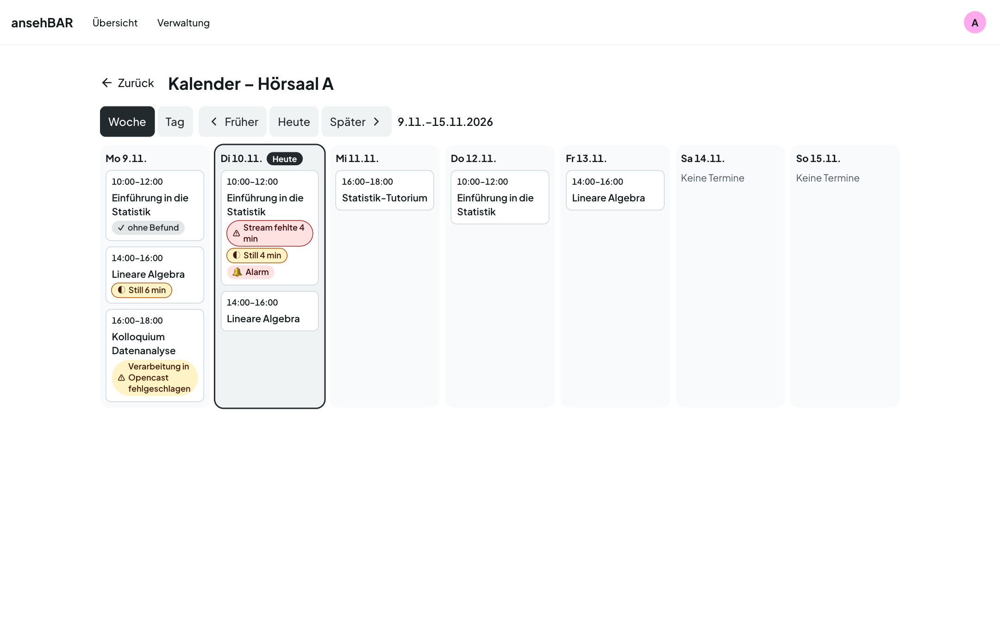
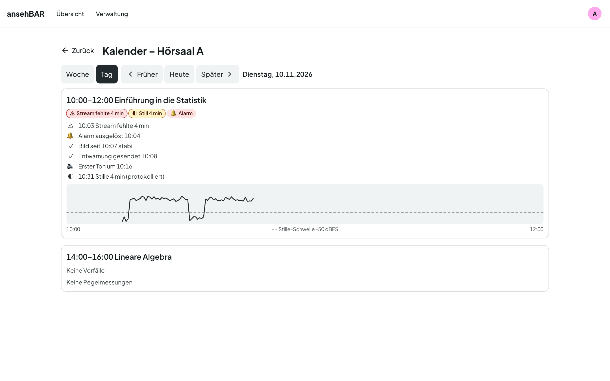

# Raumkalender

Der Raumkalender zeigt die Opencast-Termine eines Raums und was dabei
passiert ist. Sie öffnen ihn über **Kalender** in der
[Raumansicht](raumansicht.md).

## Woche

Die Woche reicht von Montag bis Sonntag; der heutige Tag ist markiert. Jeder
Termin steht als Karte mit Zeitfenster und Titel. **Marker** fassen zusammen,
was passiert ist:

| Marker | Bedeutung |
|---|---|
| ⚠ Stream fehlte 4 min | Summe der Zeit, in der der Stream fehlte |
| ◐ Still 6 min | Summe der protokollierten Stillen |
| 🔔 Alarm | Mindestens ein Alarm wurde ausgelöst. |
| ⚠ Verarbeitung in Opencast fehlgeschlagen | Opencast meldet ein Problem mit der Aufzeichnung, etwa fehlgeschlagene Aufzeichnung oder Verarbeitung, oder sie wurde nicht gestartet oder nicht abgeschlossen. |
| ✓ ohne Befund | Der Termin ist vorbei, und es gab nichts davon. |

Ein Klick auf eine Karte öffnet diesen Tag.

## Tag

In der Tagesansicht ist jeder Termin aufgeklappt: Marker, die
[Zeitleiste](raumansicht.md#termin-und-zeitleiste) und die
[Pegelkurve](raumansicht.md#pegelkurve).

## Blättern

**Woche** und **Tag** schalten die Ansicht um, **Früher** und **Später**
blättern, **Heute** springt zurück. Die Adresse enthält Ansicht und Datum —
ein Lesezeichen oder ein geteilter Link öffnet genau diese Woche oder diesen
Tag.

## Ausgetauschte Rekorder

Wird in einem Raum der Rekorder getauscht, bleibt die Historie beim alten
Rekorder. Der Kalender zeigt trotzdem beide zusammen: Er fasst alle Rekorder
mit genau demselben Raumnamen zusammen und schreibt dann den Stream-Namen an
jeden Termin.

## Wie lange die Daten bleiben

Pegelmessungen bleiben standardmäßig 30 Tage, Termine und Vorfälle 400 Tage.
Die Fristen lassen sich unter [Einstellungen](einstellungen.md#aufbewahrung)
ändern.
