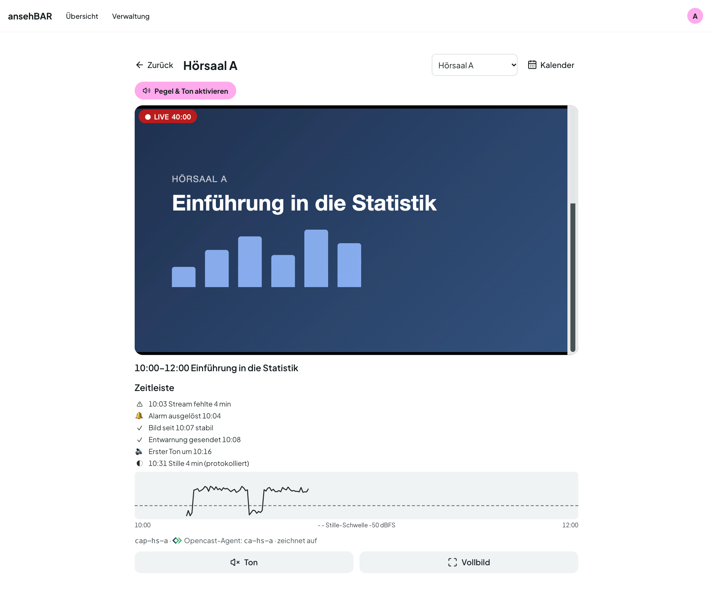
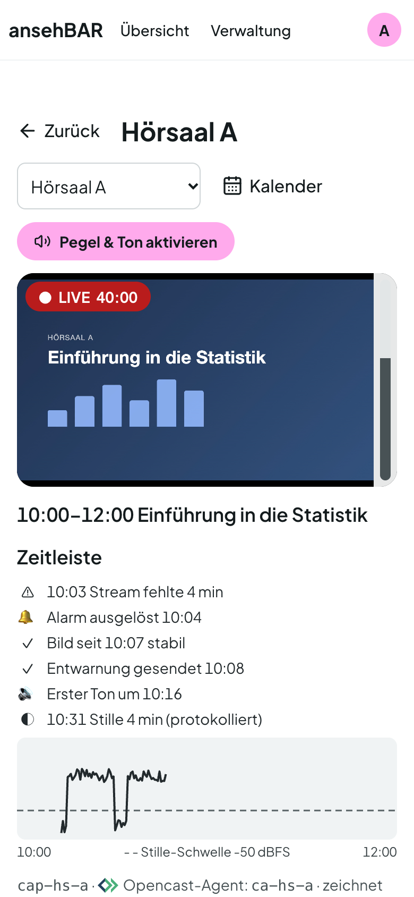

# Raumansicht

Ein Klick auf eine Kachel oder einen Raum öffnet die Raumansicht. Sie hat eine
eigene Adresse (`/raum/<nummer>`), die Sie als Lesezeichen speichern oder
weitergeben können.

## Kopf

- **Zurück** führt zur Übersicht.
- Die Auswahl **Raum wechseln** springt direkt in einen anderen Raum.
- **Kalender** öffnet den [Raumkalender](kalender.md) dieses Raums.

## Player

Großer Player mit Pegelanzeige, oben links der Status mit Laufzeit
(„● LIVE 40:00“). Darunter:

- **Ton** schaltet den Ton dieses Raums ein oder aus (vorher einmal **Pegel &
  Ton aktivieren**, siehe [Übersicht](uebersicht.md#pegel-und-ton)).
- **Vollbild** zeigt das Video bildschirmfüllend.

Sendet der Raum nicht, steht statt des Players ein klarer Hinweis, etwa
„Kein Stream – keine Aufzeichnung geplant“ oder „Stream fehlt – seit 12 min“.
Kommt der Stream, startet der Player von selbst.

## Termin und Zeitleiste

Unter dem Player stehen Zeitfenster und Titel des laufenden Opencast-Termins,
darunter die **Zeitleiste** dieses Termins:

| Eintrag | Bedeutung |
|---|---|
| ⚠ 10:03 Stream fehlte 4 min | Der Stream fehlte während des Termins. |
| ⚠ Stream fehlt seit 10:03 | Der Stream fehlt gerade. |
| 🔔 Alarm ausgelöst 10:04 | Für diesen Vorfall ging ein [Alarm](alarme.md) raus. |
| ✓ Entwarnung gesendet 10:08 | Der Stream kam stabil zurück; die Entwarnung ging raus. |
| ✓ Bild seit 10:07 stabil | Der Stream läuft seit dieser Zeit ohne Unterbrechung. |
| 🔊 Erster Ton um 10:16 | Ab hier war zum ersten Mal Ton zu hören. |
| ◐ 10:31 Stille 4 min (protokolliert) | Eine kürzere Stille, etwa eine Pause; nur protokolliert. |
| ◐ Still seit 10:31 | Es ist gerade still. |

Die Zeitleiste aktualisiert sich alle 30 Sekunden.

## Pegelkurve

Die Kurve zeigt den vom Server gemessenen Pegel über die Dauer des Termins.
Die gestrichelte Linie ist die **Stille-Schwelle**: Alles darunter zählt als
still. Lücken in der Kurve sind Zeiten ohne Messung, etwa weil der Stream
fehlte.

Die Kurve hilft auch beim Einstellen der Schwelle: Liegen Vortrag und Pause
deutlich auseinander, gehört die Schwelle dazwischen (siehe
[Einstellungen](einstellungen.md#ton)).

## Letzte Aufzeichnung

Hatte die letzte Aufzeichnung des Raums Probleme, steht darunter ein gelber
Kasten mit Titel, Zeit und den Problemen. Weitere Angaben am Ende: Stream-Name
und der verknüpfte Opencast-Agent mit seinem Zustand (z. B. „zeichnet auf“).

## Auf dem Smartphone

Die Raumansicht ist für Smartphones gebaut: großer Player, große Knöpfe für Ton
und Vollbild, darunter die Zeitleiste.

