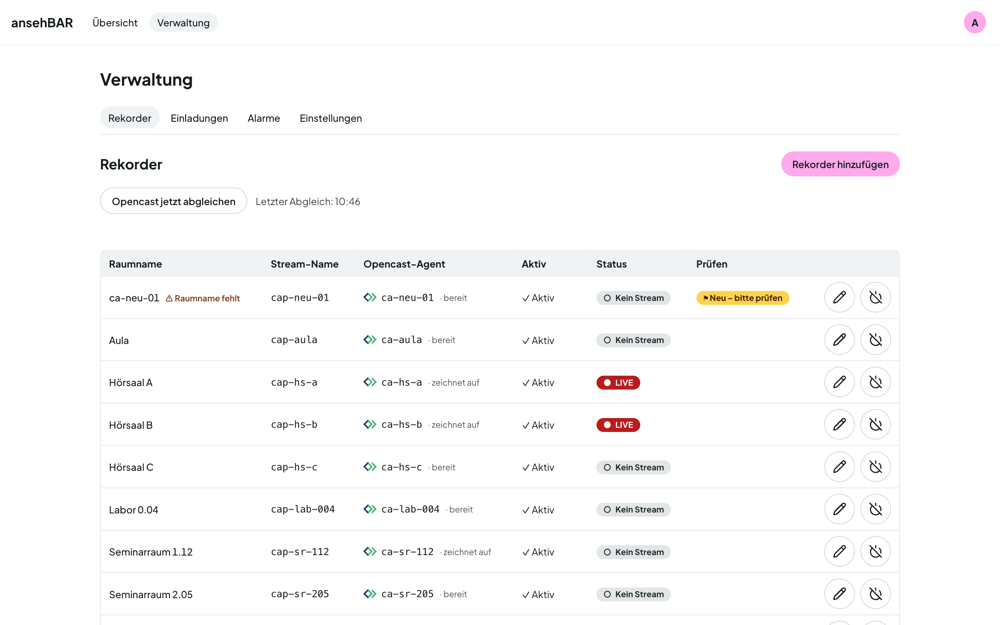

# Rekorder pflegen

Technisch hängt alles an einem **Rekorder**: Sein Stream wird geprüft, an ihm
hängen Termine und Vorfälle. Angezeigt wird überall der **Raumname**.

Unter **Verwaltung → Rekorder** sehen Sie alle Rekorder mit Raumname,
Stream-Name, Opencast-Agent, Status und ob sie aktiv sind.

## Rekorder anlegen und bearbeiten

**Rekorder hinzufügen** öffnet ein Formular; der Stift an einer Zeile
bearbeitet einen vorhandenen Rekorder.

| Feld | Bedeutung |
|---|---|
| Raumname | So heißt der Raum überall in ansehBAR, z. B. „Hörsaal A“. |
| Stream-Name | Name des Streams auf dem Streaming-Server. Groß- und Kleinschreibung zählen. |
| Opencast-Agent | Der Capture Agent in Opencast; leer, wenn nicht verknüpft. Meist gleich dem Stream-Namen. |
| Alarmmodus | Siehe unten. |
| Aktiv | Nur aktive Rekorder werden geprüft und angezeigt. |

## Neu aus Opencast

Mit Opencast-Anbindung legt ansehBAR für jeden neuen Capture Agent einen
Rekorder an. Er hat noch keinen Raumnamen und ist als **Neu – bitte prüfen**
markiert. Raumnamen eintragen und speichern — oder den Rekorder deaktivieren,
wenn er nicht gebraucht wird.

**Opencast jetzt abgleichen** holt Agents und Termine sofort, statt auf den
nächsten regelmäßigen Abgleich zu warten. ansehBAR liest dabei nur.

## Alarmmodus

| Modus | Alarm „Stream fehlt“ |
|---|---|
| **Pünktlich (Opencast-Start)** | wenn der Stream zum Opencast-Start plus Wartezeit (Standard 3 min) fehlt |
| **Raster (c.t.)** | frühestens zum Slot-Beginn plus c.t. plus Toleranz — für Räume, in denen anders gebucht oder später begonnen wird |
| **Aus (nur protokollieren)** | kein Alarm; Vorfälle erscheinen trotzdem in Zeitleiste und Kalender |

Die Zeiten dazu stehen in den [Einstellungen](einstellungen.md#alarme).

## Deaktivieren und löschen

- **Deaktivieren** nimmt einen Rekorder aus Prüfung und Übersicht; seine
  Historie bleibt.
- Nur **deaktivierte** Rekorder lassen sich löschen. Mit dem Rekorder
  verschwinden auch seine Termine und Vorfälle.
- Stammt der Rekorder aus Opencast, kommt sein Agent auf die Liste
  **Ignorierte Opencast-Agents**, damit der Abgleich ihn nicht wieder anlegt.
  „Wieder zulassen“ hebt das auf.
