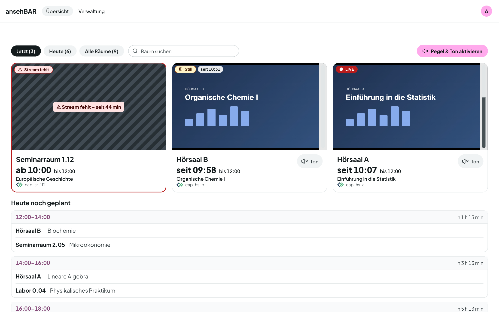
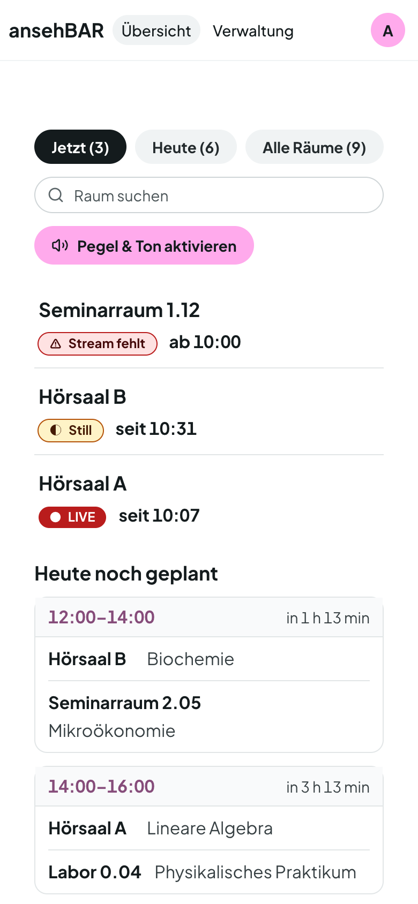

# Übersicht

Die Übersicht ist die Startseite. Sie aktualisiert sich alle paar Sekunden
selbst; laufende Videos starten dabei nicht neu.

## Kacheln

Kacheln gibt es nur für Räume, die gerade streamen oder streamen sollten.
Probleme stehen vorn: zuerst „Stream fehlt“, dann „Still“, dann die laufenden
Räume.

Jede Kachel zeigt:

- das Video (startet stumm) und rechts daneben die **Pegelanzeige**,
- oben links den **Status** — immer mit Text und Symbol,
- den **Raum**, groß darunter die Zeit („seit 10:07“ bei laufendem Stream,
  „ab 10:00“ bei fehlendem) und klein das geplante Ende,
- den Titel des Opencast-Termins und den Stream-Namen,
- den Knopf **Ton**.

## Ticket erstellen

Ist unter [Einstellungen](einstellungen.md#gitlab-tickets) ein GitLab-Projekt
eingetragen, hat jede Kachel einen Knopf **Ticket für ‹Raumname› erstellen**
(Symbol; nach dem Einrichten die Seite neu laden). Er öffnet einen Dialog:

- Zeigt die Kachel Video, enthält er einen **Screenshot** des aktuellen Bildes.
  Sonst steht dort „Kein Screenshot verfügbar – das Ticket wird ohne Screenshot
  gesendet.“
- Die **Fehlerbeschreibung** ist Pflicht; **Ticket erstellen** sendet sie ab.
- Danach führt ein Link zum Ticket in GitLab.

Das Ticket enthält Beschreibung, Raum, Stream und Capture-Agent, Zeit, Status,
den aktuellen Opencast-Termin (Titel, Serie, Vortragende, geplante Zeit), Ihren
Namen und einen Link zur Raumansicht. ansehBAR speichert nichts davon selbst.
Klappt es nicht, meldet der Dialog „Das Ticket konnte in GitLab nicht angelegt
werden.“; scheitert nur der Screenshot, entsteht das Ticket ohne Bild.

## Filter und Suche

| Filter | zeigt |
|---|---|
| **Jetzt** | Räume, die gerade streamen oder laut Opencast streamen sollten |
| **Heute** | zusätzlich die Räume, in denen heute noch etwas geplant ist |
| **Alle Räume** | alle aktiven Rekorder, auch ruhige |

Die Zahl im Filter nennt die Räume darin. Die **Suche** filtert nach Raumname
oder Stream-Name.

## Pegel und Ton

Browser spielen Ton erst nach einem Klick ab. Deshalb gibt es einmal pro Seite
den Knopf **Pegel & Ton aktivieren**. Bis dahin zeigt die Pegelanzeige den
**Serverpegel**: Der Monitor misst den Ton jedes laufenden Raums alle paar
Sekunden selbst.

Nach dem Aktivieren misst der Browser den Pegel direkt am Video, und **Ton**
an einer Kachel schaltet den Ton dieses Raums ein. Es läuft immer nur ein Ton
zur Zeit: Wer einen anderen Raum einschaltet, schaltet den vorigen stumm.

## Zustände

| Anzeige | Bedeutung |
|---|---|
| ● **LIVE** | Der Stream läuft: Seine Playlist erneuert sich laufend. |
| ◐ **Still** | Der Stream läuft, aber seit einigen Minuten ist kein Ton zu hören. |
| ⚠ **Stream fehlt** | Laut Opencast läuft eine Aufzeichnung, der Stream ist aber nicht da. Die Kachel ist rot gerahmt und gestreift. |
| **Kein Stream** | Der Rekorder sendet gerade nicht; es ist auch nichts geplant. |
| **Status unbekannt** | Der Monitor konnte den Stream nicht prüfen, etwa weil der Streaming-Server nicht antwortet. |

„Live“ heißt bei ansehBAR mehr als „die Adresse antwortet“: Der Stream gilt
erst als live, wenn sich seine Playlist innerhalb kurzer Zeit weiterbewegt.

Weitere Hinweise oben auf der Seite:

- **Monitor liefert keine Daten seit …** — der Prüfprozess selbst steht; die
  angezeigten Zustände können veraltet sein.
- **Opencast-Daten veraltet** — der Abgleich mit Opencast klappt gerade nicht;
  „Stream fehlt“ und die geplanten Termine sind dann unsicher.

## Heute noch geplant

Unter den Kacheln stehen die Aufzeichnungen, die heute noch beginnen, gruppiert
nach **Slots** (z. B. 12:00–14:00) mit „in 1 h 13 min“. Ein Termin, dessen
Beginn oder Ende vom Slot abweicht, ist markiert. Ab 17 Uhr oder wenn heute
nichts mehr ansteht, folgt **Morgen**.

Räume ohne Aufzeichnung heute stehen kompakt in einer Zeile. Ein Klick öffnet
den Raum trotzdem.

## Letzte Aufzeichnung hatte Probleme

Hatte der zuletzt beendete Termin eines Raums Probleme — der Stream fehlte, es
war lange still, oder Opencast meldet eine fehlgeschlagene Aufzeichnung oder
Verarbeitung —, zeigt die Kachel einen ⚠-Hinweis. Er verschwindet nach der
nächsten sauberen Aufzeichnung.

## Auf dem Smartphone

Auf schmalen Bildschirmen wird die Übersicht zur Raumliste mit Status und Zeit.
Ein Tipp auf einen Raum öffnet die [Raumansicht](raumansicht.md).

