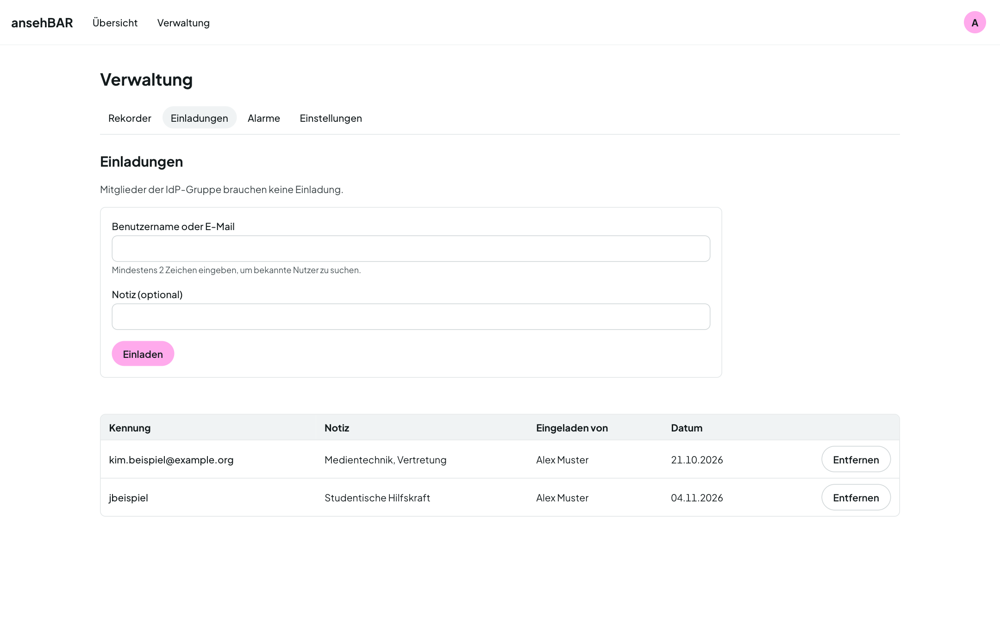

# Zugang und Einladungen

Den Grundzugang regelt die ansehBAR-Gruppe im Identity Provider Ihrer
Einrichtung (siehe [Anmelden](anmelden.md#wer-zugang-hat)). Wer nicht in der
Gruppe ist, kann eingeladen werden.

## Jemanden einladen

1. **Verwaltung → Einladungen** öffnen.
2. Benutzernamen oder E-Mail-Adresse der Person eintragen, so wie sie im
   Identity Provider steht. Groß- und Kleinschreibung spielen keine Rolle.
3. Optional eine Notiz ergänzen, z. B. „Vertretung Medientechnik“.
4. **Einladen** wählen.

Die Person meldet sich danach ganz normal an; eine E-Mail verschickt ansehBAR
dabei nicht.

## Einladung entfernen

Der Papierkorb an einer Einladung nimmt den Zugang wieder weg. Ist die Person
gerade angemeldet, gilt das ab ihrem nächsten Seitenaufruf.

!!! note "Gruppe geht vor"
    Wer in der ansehBAR-Gruppe ist, braucht keine Einladung. Eine Einladung zu
    entfernen, sperrt Gruppenmitglieder nicht aus.
