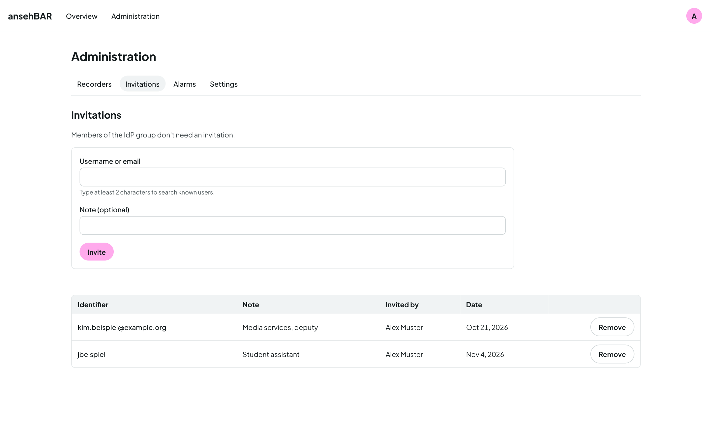

# Access and invitations

Basic access comes from the ansehBAR group in your institution's identity
provider (see [Signing in](sign-in.md#who-has-access)). People outside the
group can be invited.

## Inviting someone

1. Open **Administration → Invitations**.
2. Enter the person's username or e-mail address as it is in the identity
   provider. Upper and lower case do not matter.
3. Optionally add a note, e.g. “Media services, deputy”.
4. Choose **Invite**.

The person then simply signs in; ansehBAR does not send an e-mail.

## Removing an invitation

The bin icon on an invitation takes the access away again. If the person is
signed in, it applies from their next page request.

!!! note "The group comes first"
    Members of the ansehBAR group need no invitation. Removing an invitation
    does not lock out group members.
