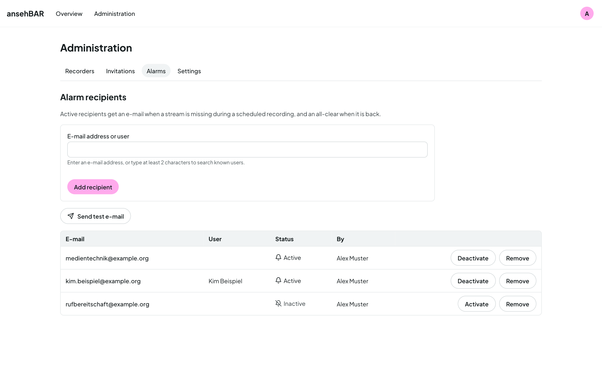

# Alarms

ansehBAR raises alarms only during scheduled Opencast events. Outside events,
“no stream” is normal and triggers nothing. Alarms therefore need the
connection to Opencast.

## Stream missing

- If the stream is missing at the start of an event or drops out, an
  **incident** is created. It is always logged and shows up in the timeline and
  the [calendar](calendar.md).
- An **alarm** goes out as soon as the stream has been missing for longer than
  the room's [alarm mode](recorders.md#alarm-mode) allows — for example 3
  minutes after the Opencast start.
- **All-clear:** if the stream runs stably again for at least a minute after
  an alarm, an all-clear goes to the same recipients.
- Brief flickering is no outage. If the stream drops out again after an
  all-clear, there is a new alarm.
- If the stream ends shortly before the scheduled end, that is no incident.

## Sound missing

- During running events the monitor measures the level of every room.
- A silence of 2 minutes or more is **logged** (breaks, quiet work).
- An **alarm** goes out only when it has been silent for more than 15 minutes
  without interruption — and only once per event.
- If the sound comes back after an alarm, an all-clear is sent by e-mail.

Threshold and times are under [Settings](settings.md#sound).

## Who gets the alarms

Under **Administration → Alarms** you manage the recipients:

- **Add recipient:** enter an e-mail address or search for a person who has
  signed in to ansehBAR before.
- Each recipient can be **activated or deactivated** individually, for example
  during holidays, and removed.
- **Send test e-mail** sends a test message to all active recipients.

An alarm e-mail contains everything needed to pass it on: room, recorder, kind
of problem, event with title and scheduled time, since when, and a link to the
room view.

## Monitoring service

ansehBAR can also hand its alarms to a monitoring service (Prometheus with
Alertmanager). The service polls ansehBAR regularly and distributes the alarms
itself, for example to a chat room. There are no all-clears on this channel.
The setup is described under [Installation](../installation.md).

Both channels can be switched off individually under
[Settings](settings.md#alarms).
