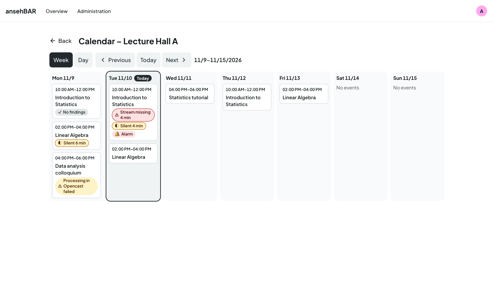
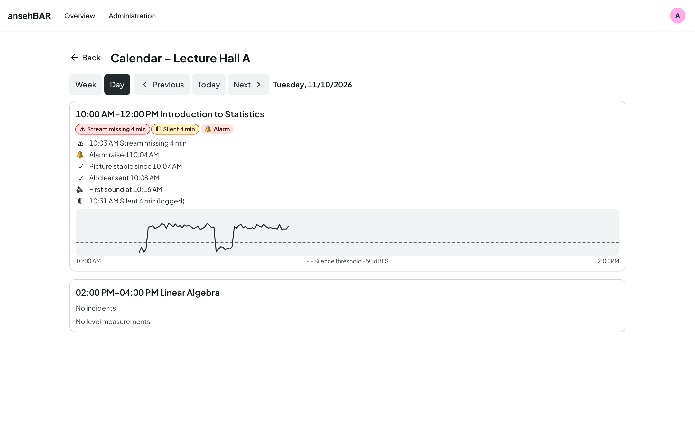

# Room calendar

The room calendar shows a room's Opencast events and what happened during
them. Open it with **Calendar** in the [room view](room-view.md).

## Week

The week runs from Monday to Sunday; today is marked. Each event is a card
with time window and title. **Markers** summarise what happened:

| Marker | Meaning |
|---|---|
| ⚠ Stream missing 4 min | total time the stream was missing |
| ◐ Silent 6 min | total of the logged silences |
| 🔔 Alarm | at least one alarm was raised |
| ⚠ Processing in Opencast failed | Opencast reports a problem with the recording, e.g. failed recording or processing, or it did not start or finish. |
| ✓ No findings | the event is over and none of the above happened |

Clicking a card opens that day.

## Day

In the day view every event is expanded: markers, the
[timeline](room-view.md#event-and-timeline) and the
[level curve](room-view.md#level-curve).

## Paging

**Week** and **Day** switch the view, **Previous** and **Next** page through,
**Today** jumps back. The address contains view and date — a bookmark or a
shared link opens exactly this week or day.

## Replaced recorders

When the recorder in a room is replaced, the history stays with the old
recorder. The calendar still shows both together: it combines all recorders
with exactly the same room name and then adds the stream name to each event.

## How long data is kept

Level measurements are kept for 30 days by default, events and incidents for
400 days. The periods can be changed under
[Settings](settings.md#retention).
