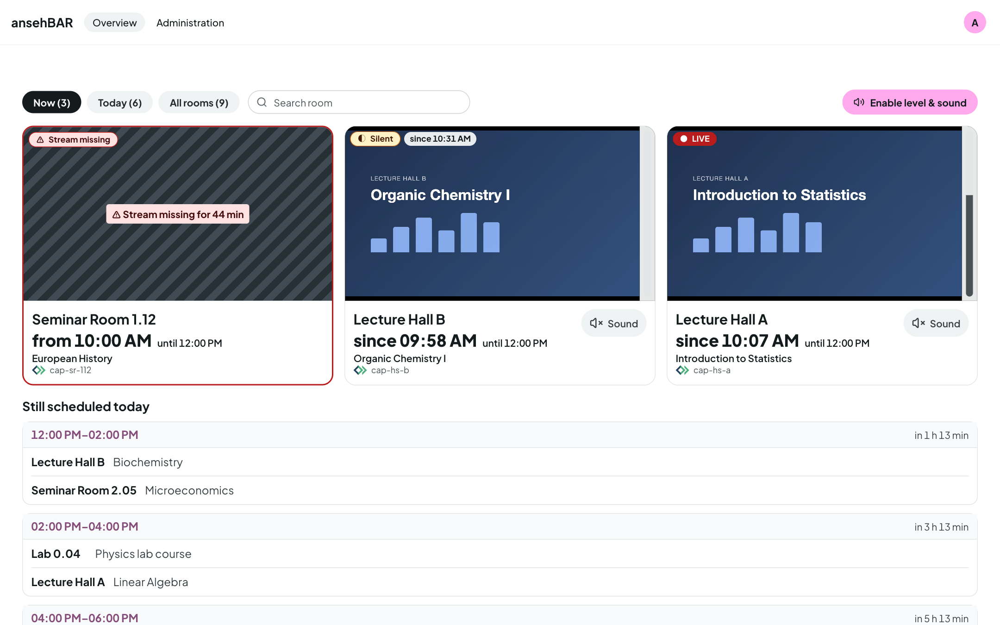

# Guide

ansehBAR shows which recording rooms are streaming live right now and checks
picture and sound. Connected to Opencast, ansehBAR also knows when a recording
is scheduled in which room. Then it also shows where a stream is **missing**
and sends alarms.

The recorders stream live during every recording: camera and screen in one
video. If the live stream is missing, the recording is usually affected as
well. That is why the stream is worth watching.

## Chapters

-   :material-login: __[Signing in](sign-in.md)__

    Who has access and how signing in works.

-   :material-view-grid-outline: __[Overview](overview.md)__

    Tiles, filters, sound, “Still scheduled today” and the room states.

-   :material-television-play: __[Room view](room-view.md)__

    A single room with a large player, timeline and level curve — on the phone
    too.

-   :material-calendar-week: __[Room calendar](calendar.md)__

    The week and the day of a room with incidents and Opencast problems.

-   :material-bell-outline: __[Alarms](alarms.md)__

    When ansehBAR raises an alarm, who gets the e-mails and what “all-clear”
    means.

-   :material-video-box: __[Managing recorders](recorders.md)__

    Add rooms, link them to Opencast, choose the alarm mode.

-   :material-account-plus-outline: __[Access and invitations](access.md)__

    Give more people access.

-   :material-tune: __[Settings](settings.md)__

    Stream URL, slots, alarm times, silence threshold and retention.

!!! info "ansehBAR only watches"
    ansehBAR changes nothing on the recorders and never writes to Opencast or
    the identity provider. It reads streams and schedules and shows what it
    sees.
