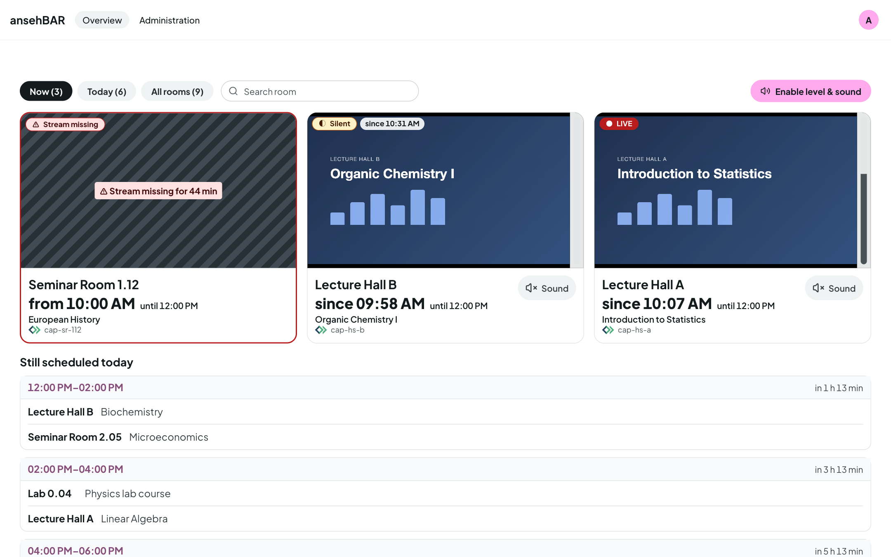
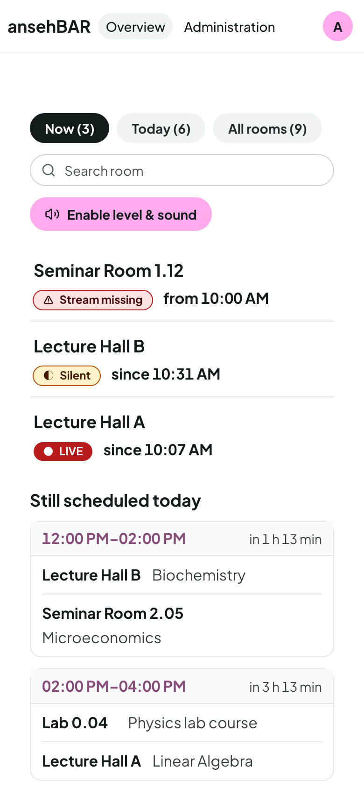

# Overview

The overview is the start page. It refreshes itself every few seconds;
running videos do not restart.

## Tiles

There are tiles only for rooms that are streaming or should be. Problems come
first: “Stream missing” first, then “Silent”, then the running rooms.

Each tile shows:

- the video (starts muted) and the **level meter** next to it,
- the **status** at the top left — always with text and symbol,
- the **room**, below it in large type the time (“since 10:07” for a running
  stream, “from 10:00” for a missing one) and, smaller, the scheduled end,
- the title of the Opencast event and the stream name,
- the **Sound** button.

## Filters and search

| Filter | shows |
|---|---|
| **Now** | rooms that are streaming or should be according to Opencast |
| **Today** | also the rooms with something still scheduled today |
| **All rooms** | all recorders, quiet ones included |

The number in a filter counts its rooms. **Search** filters by room name,
stream name or Opencast agent.

## Level and sound

Browsers play sound only after a click. That is why each page has the button
**Enable level & sound** once. Until then the level meter shows the **server
level**: the monitor measures the sound of every running room itself every
few seconds.

After enabling, the browser measures the level directly from the video, and
**Sound** on a tile switches that room's sound on. Only one room plays sound at
a time: switching another room on mutes the previous one.

## States

| Display | Meaning |
|---|---|
| ● **LIVE** | The stream is running: its playlist keeps advancing. |
| ◐ **Silent** | The stream is running, but no sound has been heard for a few minutes. |
| ⚠ **Stream missing** | According to Opencast a recording is running, but the stream is not there. The tile has a red frame and stripes. |
| **No stream** | The recorder is not sending right now; nothing is scheduled either. |
| **Status unknown** | The monitor could not check the stream, for example because the streaming server does not answer. |

In ansehBAR, “live” means more than “the address answers”: a stream counts as
live only when its playlist moves on within a short time.

Further notices at the top of the page:

- **Monitor has delivered no data since …** — the checking process itself has
  stopped; the states shown may be outdated.
- **Opencast data out of date** — the sync with Opencast is failing right now;
  “Stream missing” and the scheduled events are uncertain then.

## Still scheduled today

Below the tiles are the recordings that still start today, grouped by
**slots** (e.g. 12:00–14:00) with “in 1 h 13 min”. An event whose start or end
differs from the slot is marked. From 5 pm, or when nothing more is scheduled
today, **Tomorrow** follows.

Rooms without a recording today are listed compactly in one line. A click
still opens the room.

## Last recording had problems

If a room's most recently finished event had problems — the stream was
missing, it was silent for long, or Opencast reports a failed recording or
processing — the tile shows a ⚠ notice. It disappears after the next clean
recording.

## On the phone

On narrow screens the overview becomes a room list with status and time.
Tapping a room opens the [room view](room-view.md).

