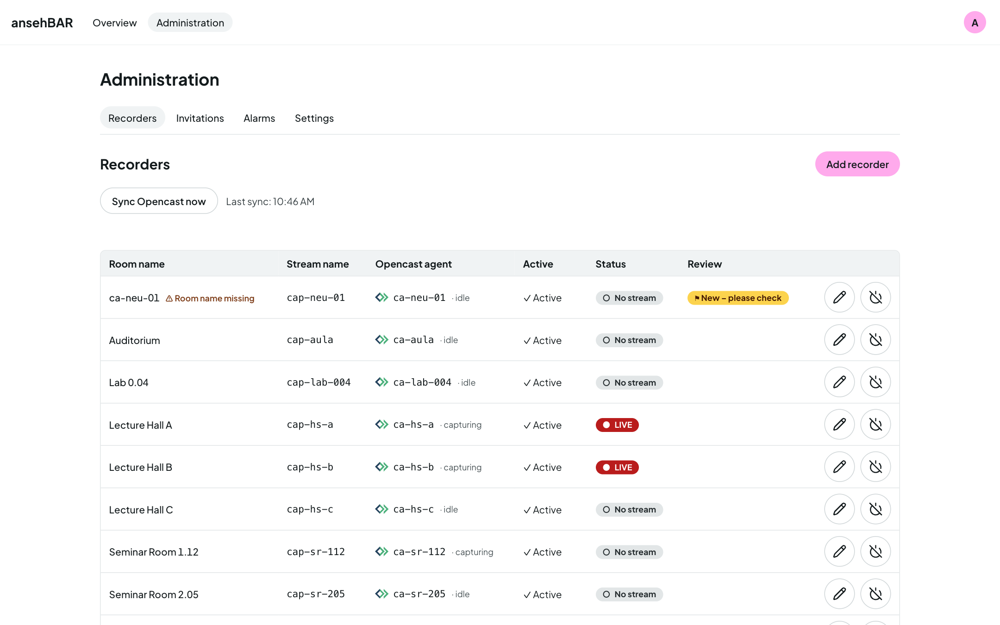

# Managing recorders

Technically everything hangs on a **recorder**: its stream is checked, events
and incidents belong to it. What you see everywhere is the **room name**.

**Administration → Recorders** lists all recorders with room name, stream
name, Opencast agent, status and whether they are active.

## Adding and editing recorders

**Add recorder** opens a form; the pencil on a row edits an existing recorder.

| Field | Meaning |
|---|---|
| Room name | What the room is called everywhere in ansehBAR, e.g. “Lecture Hall A”. |
| Stream name | Name of the stream on the streaming server. Upper and lower case matter. |
| Opencast agent | The capture agent in Opencast; empty if not linked. Usually the same as the stream name. |
| Alarm mode | See below. |
| Active | Only active recorders are checked and shown. |

## New from Opencast

With the Opencast connection, ansehBAR creates a recorder for every new
capture agent. It has no room name yet and is marked **New – please check**.
Enter a room name and save — or deactivate the recorder if it is not needed.

**Sync Opencast now** fetches agents and events immediately instead of waiting
for the next regular sync. ansehBAR only reads.

## Alarm mode

| Mode | Alarm “Stream missing” |
|---|---|
| **On time (Opencast start)** | when the stream is missing at the Opencast start plus the grace period (3 min by default) |
| **Grid (c.t.)** | at the earliest at slot start plus c.t. plus tolerance — for rooms that book differently or start later |
| **Off (log only)** | no alarm; incidents still appear in the timeline and calendar |

The matching times are under [Settings](settings.md#alarms).

## Deactivating and deleting

- **Deactivate** takes a recorder out of checking and the overview; its
  history stays.
- Only **deactivated** recorders can be deleted. Its events and incidents
  disappear with the recorder.
- If the recorder came from Opencast, its agent goes onto the list **Ignored
  Opencast agents** so the sync does not create it again. “Allow again” undoes
  that.
