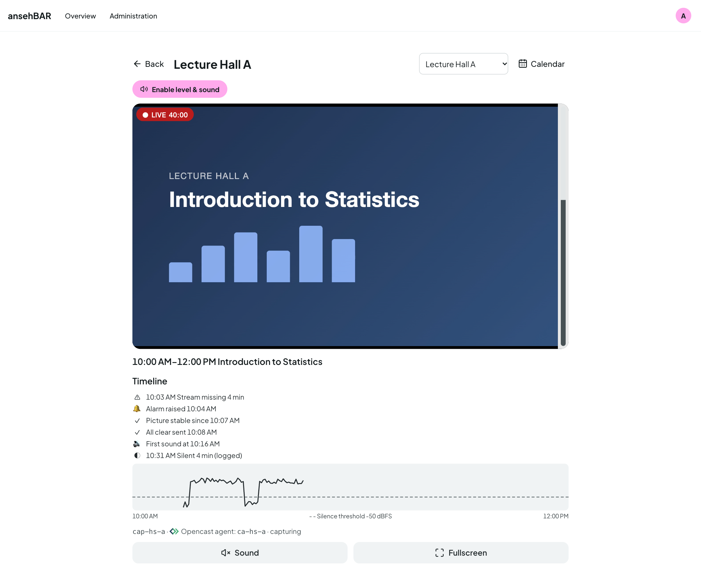
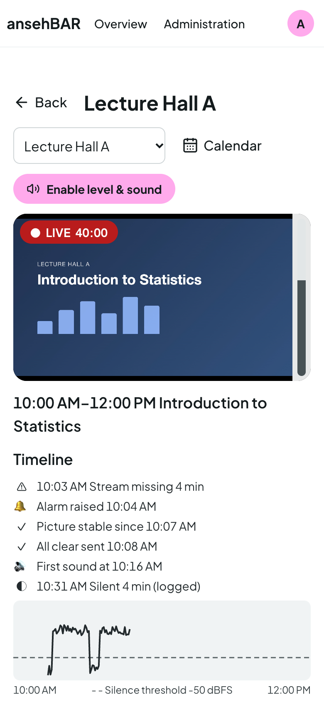

# Room view

Clicking a tile or a room opens the room view. It has its own address
(`/raum/<number>`) that you can bookmark or share.

## Header

- **Back** returns to the overview.
- **Switch room** jumps straight to another room.
- **Calendar** opens this room's [room calendar](calendar.md).

## Player

A large player with level meter, the status with running time at the top left
(“● LIVE 40:00”). Below it:

- **Sound** switches this room's sound on or off (first **Enable level &
  sound** once, see [Overview](overview.md#level-and-sound)).
- **Fullscreen** shows the video full screen.

If the room is not sending, a clear notice replaces the player, for example
“No stream – no recording scheduled” or “Stream missing for 12 min”. When
the stream comes, the player starts by itself.

## Event and timeline

Below the player are the time window and title of the running Opencast event,
followed by the **timeline** of this event:

| Entry | Meaning |
|---|---|
| ⚠ 10:03 Stream missing 4 min | The stream was missing during the event. |
| ⚠ Stream missing since 10:03 | The stream is missing right now. |
| 🔔 Alarm raised 10:04 | An [alarm](alarms.md) went out for this incident. |
| ✓ All clear sent 10:08 | The stream came back stably; the all-clear went out. |
| ✓ Picture stable since 10:07 | The stream has been running without interruption since then. |
| 🔊 First sound at 10:16 | Sound was heard for the first time here. |
| ◐ 10:31 Silent 4 min (logged) | A shorter silence, such as a break; only logged. |
| ◐ Silent since 10:31 | It is silent right now. |

The timeline refreshes every 30 seconds.

## Level curve

The curve shows the level measured by the server over the event. The dashed
line is the **silence threshold**: everything below it counts as silent. Gaps
in the curve are times without a measurement, for example because the stream
was missing.

The curve also helps to set the threshold: if talk and break are clearly
apart, the threshold belongs in between (see
[Settings](settings.md#sound)).

## Last recording

If the room's last recording had problems, a yellow box below lists title,
time and the problems. At the end: the stream name and the linked Opencast
agent with its state (e.g. “capturing”).

## On the phone

The room view is built for phones: a large player, large buttons for sound and
full screen, the timeline below.

