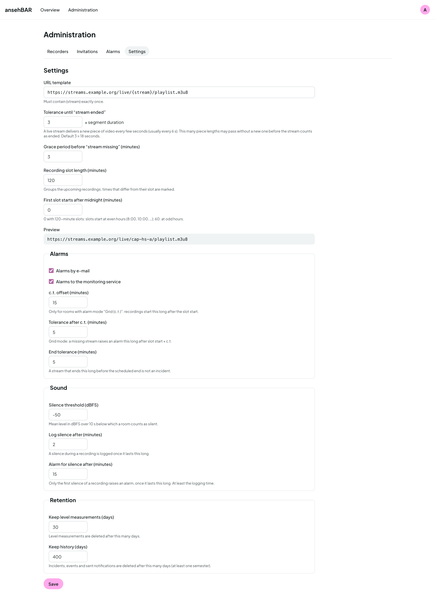

# Settings

**Administration → Settings** holds the values that apply to all rooms. Each
field explains itself with a short hint; **Save** applies everything at once.

## Stream

| Setting | Meaning | Default |
|---|---|---|
| URL template | Address of the streams; `{stream}` is replaced by the stream name. The preview shows the result. | — |
| Tolerance until “stream ended” | This many segment durations may pass without a new video segment before a stream counts as ended. | 3 |
| Wait until “stream missing” | Minutes after the event start before a missing stream counts | 3 |
| Length of a recording slot | groups “Still scheduled today”; times that differ from the slot are marked | 120 |
| Slots start after midnight | 0 with 120 minutes: slots start at even hours | 0 |

## Alarms

| Setting | Meaning | Default |
|---|---|---|
| Alarms by e-mail | channel on or off | on |
| Alarms to the monitoring service | channel on or off | on |
| c.t. offset | only for rooms in mode “Grid (c.t.)”: recordings start this long after the slot start | 15 |
| Tolerance after c.t. | grid mode: a missing stream raises an alarm this long after slot start + c.t. | 5 |
| End tolerance | if a stream ends at most this long before the scheduled end, that is no incident | 5 |

## Sound

| Setting | Meaning | Default |
|---|---|---|
| Silence threshold (dBFS) | mean level over 10 s below which a room counts as silent | −50 |
| Log silence from | minutes from which a silence is logged | 2 |
| Alarm on silence from | minutes of uninterrupted silence until the alarm (only once per event) | 15 |

**Setting the threshold:** open the level curve of a few lectures in the
[room view](room-view.md#level-curve) or the [calendar](calendar.md#day). If
the talk sits at around −25 dBFS and a break at −60 dBFS, a threshold in
between fits.

## Retention

| Setting | Meaning | Default |
|---|---|---|
| Keep level measurements | days the individual measurements (basis of the level curve) are kept | 30 |
| Keep history | days events, incidents and sent notifications are kept; at least one semester (183) | 400 |

The monitor deletes older data once an hour.
