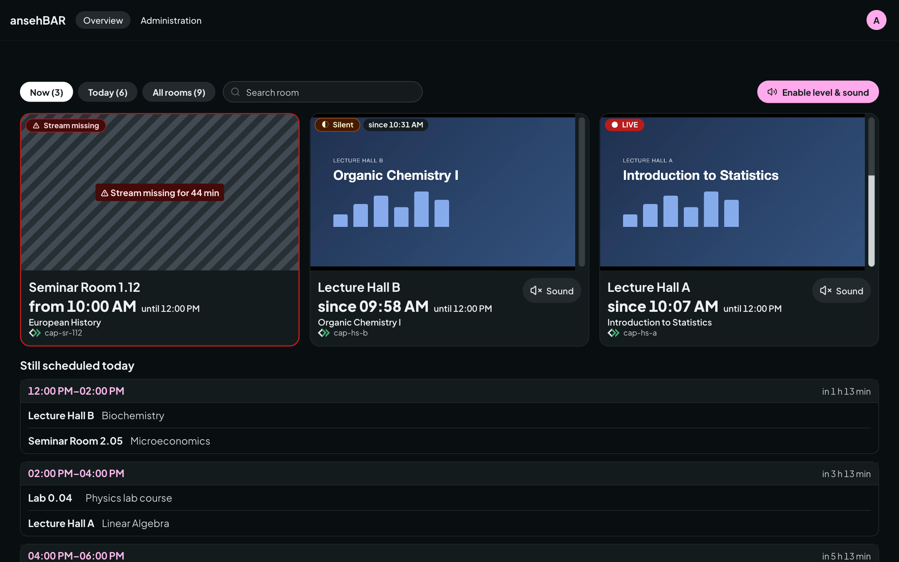

# Signing in

ansehBAR is a tool for a small group of people, such as media services and the
lecture capture team. The streams are not a public service.

## How to sign in

1. Open ansehBAR in the browser and choose **Sign in**.
2. Sign in with your institution's account. ansehBAR uses your institution's
   identity provider (OIDC, e.g. Keycloak); there is no separate password.
3. The [overview](overview.md) opens.

## Who has access

You have access if at least one of these applies:

- **Group:** you belong to the ansehBAR group in the identity provider. Group
  membership is read at every sign-in; whoever is removed from the group loses
  access at the next sign-in.
- **Invitation:** someone with access has invited you under
  [Administration → Invitations](access.md) with your username or e-mail
  address.
- **Initial setup:** during installation, the operators enter a few accounts
  directly so the first people can get in.

If you sign in without access, ansehBAR shows a page telling you whom to
contact.

## Language and theme

The menu at the top right sets the language (German or English) and the theme
(light, dark or like the system).

