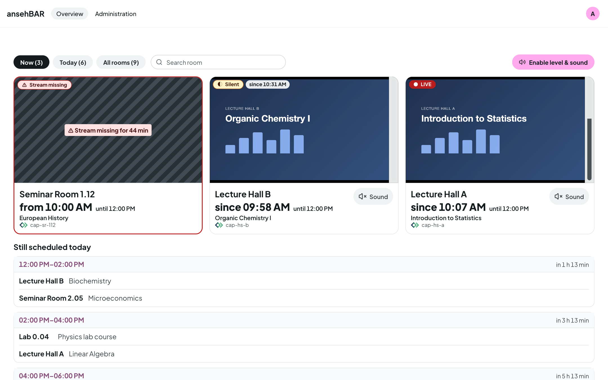
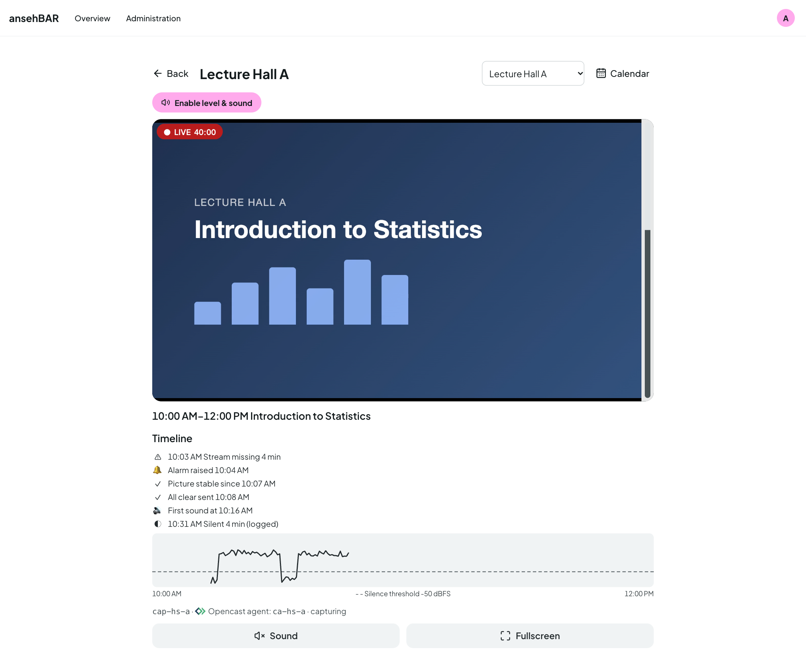
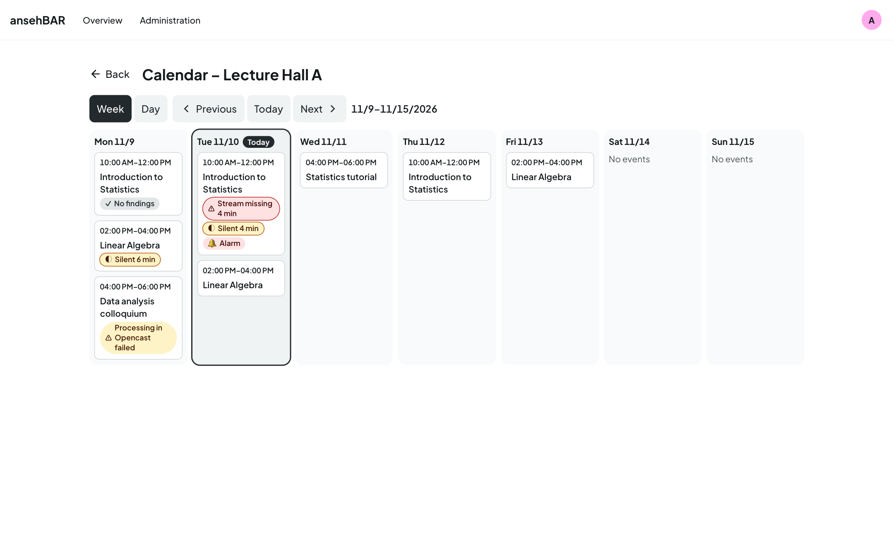
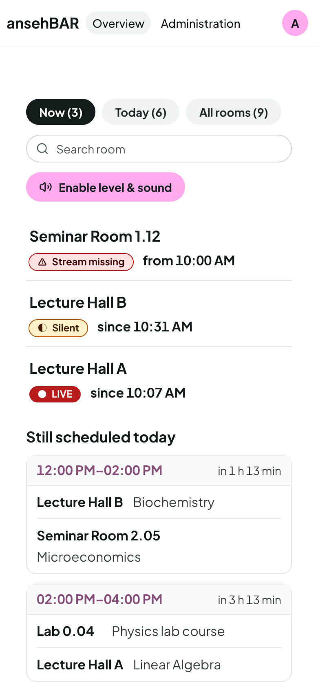
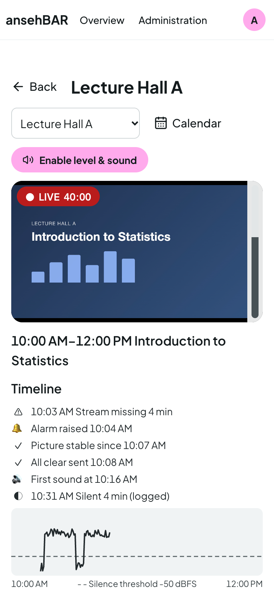
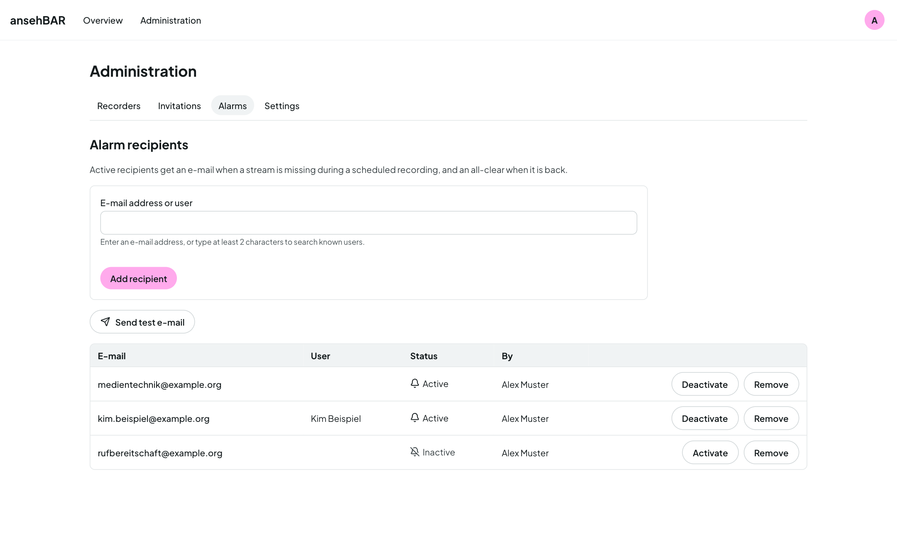

Open source · virtUOS, Osnabrück University

<h1 class="as-hero__title">Every lecture hall at a glance — picture, sound and schedule.</h1>

The recorders in the lecture halls record and stream live at the same time.
When the stream is missing, the recording usually is too. ansehBAR shows which
rooms are on air, checks picture and sound and speaks up when something is
missing during a scheduled event — before the recording is lost.

[Guide](guide/index.md){ .md-button .md-button--primary }
[:fontawesome-brands-github: Source code on GitHub](https://github.com/virtUOS/ansehbar){ .md-button }

<figure class="as-shot as-shot--hero" markdown>

</figure>

<ul class="as-facts">
  <li><strong>Live detection</strong>from the chunklist, not just the HTTP status</li>
  <li><strong>Sound level</strong>measured in the browser and on the server</li>
  <li><strong>Opencast</strong>scheduled events, read-only</li>
  <li><strong>Alarms</strong>by e-mail and for Prometheus</li>
  <li><strong>GitLab tickets</strong>with status, event and screenshot</li>
  <li><strong>German &amp; English</strong>on desktop and phone</li>
</ul>

## What ansehBAR does { .as-section-title }

A monitoring tool for media services and lecture capture teams: it watches streams and Opencast schedules and changes nothing on recorders, Opencast or the identity provider.

### Room view with timeline

A large player with sound and full screen, below it the events of the running
recording: when the stream was missing, when alarm and all-clear went out,
when sound started — and the measured level curve.

### Room calendar

The week and the day of a room with all Opencast events. Markers show where
the stream was missing, where it was silent, where an alarm was raised and
which recording failed in Opencast.

### On the go

On a phone the overview becomes a room list. A tap opens the room with a large
player, sound and full screen — handy for important events right in the
lecture hall.

### Alarms that fit

An alarm when the stream is missing during an event or when it stays silent
for long; an all-clear when everything runs again. Per room: on time from the
Opencast start, by grid with c.t., or log only.

-   :material-traffic-light-outline: __Clear states__

    Always text and symbol, never colour alone: Live, Silent, Stream missing,
    No stream, Status unknown — and a notice when the monitor itself stops
    delivering data.

-   :material-volume-high: __Check the sound__

    A level meter per tile, even with muted video. Only one room plays sound
    at a time — switching another one on mutes the previous one.

-   :material-alert-outline: __Last recording__

    If a room's last recording had problems, tile and room view say so — until
    the next clean recording.

-   :material-theme-light-dark: __Light and dark__

    The interface follows your system or your choice, in German or English.

## Who it is for { .as-section-title }

-   :material-video-account: __Media services and lecture capture teams__

    ---

    All running rooms on the desktop, a single room on the phone. Alarms by
    e-mail to the people who can act.

    [:octicons-arrow-right-24: To the guide](guide/index.md)

-   :material-server-network: __Universities and IT centres__

    ---

    Self-hosted with Docker Compose, sign-in through your own identity
    provider (OIDC), connected to Opencast and Prometheus.

    [:octicons-arrow-right-24: To the installation](installation.md)

## Watch, don't touch { .as-section-title }

-   :material-eye-outline: __Read-only__

    ansehBAR never writes to Opencast or the identity provider and controls no
    recorders. It reads streams and schedules — nothing more.

-   :material-account-lock-outline: __Small group of users__

    Access through a group in the identity provider or by invitation. The
    streams are not a public service.

-   :material-scale-balance: __Open source__

    All source code is available under the Apache License 2.0 on
    [GitHub](https://github.com/virtUOS/ansehbar).

-   :material-domain: __Made at a university__

    Developed by virtUOS at Osnabrück University, as one of the BAR tools
    alongside abstimmBAR and ausleihBAR.

## Installation { .as-cta__title }

ansehBAR runs as a Docker Compose stack of PostgreSQL, Django, a monitor
process and Caddy on your own Linux server — with automatic HTTPS and sign-in
via OIDC. Opencast, e-mail and Prometheus are optional.

[To the installation](installation.md){ .md-button .md-button--primary }

