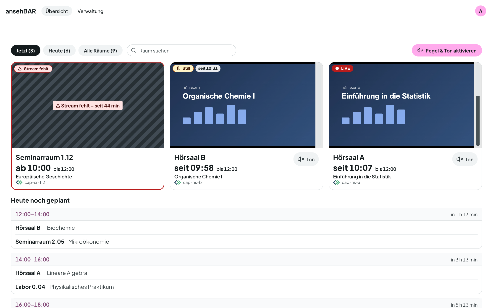
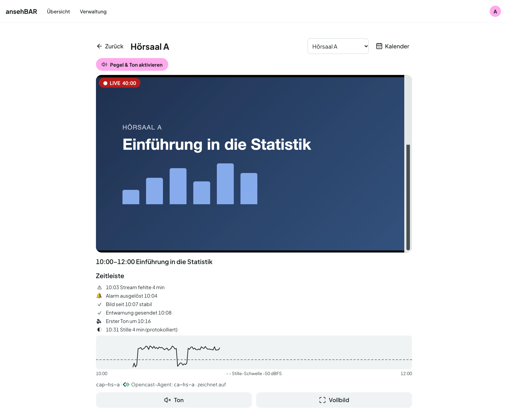
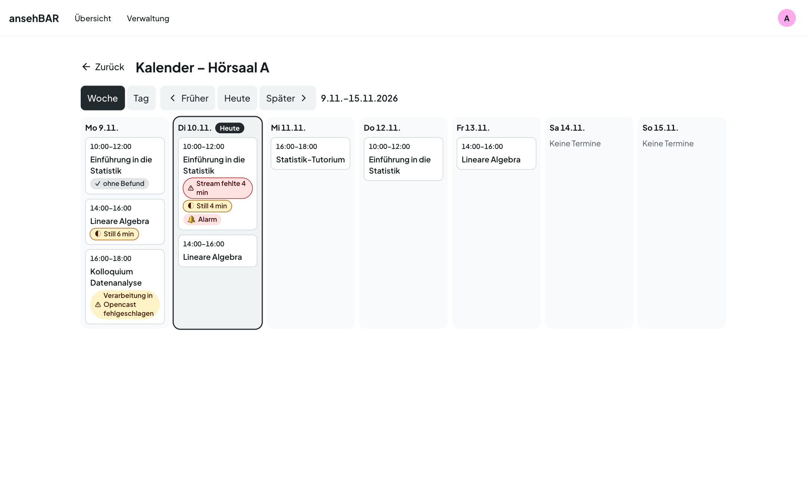
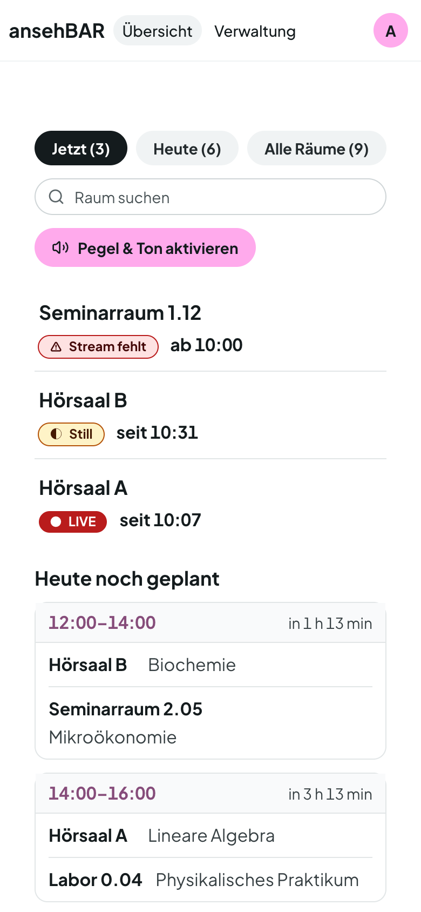
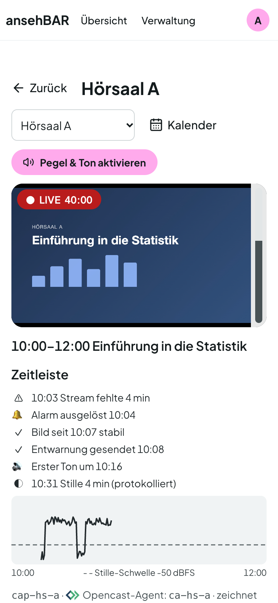
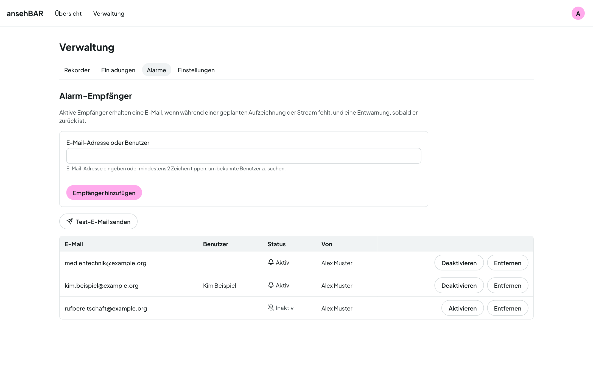

Open Source · virtUOS, Universität Osnabrück

<h1 class="as-hero__title">Jeder Hörsaal auf einen Blick — Bild, Ton und Termin.</h1>

Die Rekorder in den Hörsälen zeichnen auf und streamen dabei live. Fehlt der
Stream, fehlt meist auch die Aufzeichnung. ansehBAR zeigt, welche Räume gerade
senden, prüft Bild und Ton und meldet sich, wenn während eines geplanten
Termins etwas fehlt — bevor die Aufzeichnung verloren ist.

[Anleitung](anleitung/index.md){ .md-button .md-button--primary }
[:fontawesome-brands-github: Quellcode auf GitHub](https://github.com/virtUOS/ansehbar){ .md-button }

<figure class="as-shot as-shot--hero" markdown>

</figure>

<ul class="as-facts">
  <li><strong>Live-Erkennung</strong>an der Chunklist, nicht nur am HTTP-Status</li>
  <li><strong>Ton-Pegel</strong>im Browser und vom Server gemessen</li>
  <li><strong>Opencast</strong>geplante Termine, nur lesend</li>
  <li><strong>Alarme</strong>per E-Mail und für Prometheus</li>
  <li><strong>GitLab-Tickets</strong>mit Status, Termin und Screenshot</li>
  <li><strong>Deutsch &amp; Englisch</strong>am PC und auf dem Smartphone</li>
</ul>

## Was ansehBAR kann { .as-section-title }

Ein Kontrollwerkzeug für Medientechnik und Aufzeichnungsteams: Es beobachtet Streams und Opencast-Termine und verändert nichts an Rekordern, Opencast oder Anmeldedienst.

### Raumansicht mit Zeitleiste

Großer Player mit Ton und Vollbild, darunter die Ereignisse des laufenden
Termins: wann der Stream fehlte, wann Alarm und Entwarnung rausgingen, ab wann
Ton da war — und der gemessene Pegelverlauf.

### Raumkalender

Woche und Tag eines Raums mit allen Opencast-Terminen. Marker zeigen, wo der
Stream fehlte, wo es still war, wo ein Alarm ausgelöst wurde und welche
Aufzeichnung in Opencast gescheitert ist.

### Auch unterwegs

Auf dem Smartphone wird die Übersicht zur Raumliste. Ein Tipp öffnet den Raum
mit großem Player, Ton und Vollbild — praktisch bei wichtigen Veranstaltungen
direkt im Hörsaal.

### Alarme, die passen

Alarm, wenn während eines Termins der Stream fehlt oder lange Stille herrscht;
Entwarnung, wenn alles wieder läuft. Pro Raum einstellbar: pünktlich zum
Opencast-Start, nach Raster mit c.t. oder nur protokollieren.

-   :material-traffic-light-outline: __Klare Zustände__

    Immer Text und Symbol, nie nur Farbe: Live, Still, Stream fehlt, Kein
    Stream, Status unbekannt — und ein Hinweis, wenn der Monitor selbst keine
    Daten mehr liefert.

-   :material-volume-high: __Ton prüfen__

    Pegel pro Kachel, auch bei stummem Video. Es läuft immer nur ein Ton —
    wer einen anderen Raum einschaltet, schaltet den vorigen stumm.

-   :material-alert-outline: __Letzte Aufzeichnung__

    Hatte die letzte Aufzeichnung eines Raums Probleme, steht das in Kachel
    und Raumansicht — bis zur nächsten sauberen Aufzeichnung.

-   :material-theme-light-dark: __Hell und dunkel__

    Die Oberfläche folgt dem System oder Ihrer Wahl, auf Deutsch oder
    Englisch.

## Für wen { .as-section-title }

-   :material-video-account: __Medientechnik und Aufzeichnungsteams__

    ---

    Am PC alle laufenden Räume im Blick, unterwegs der einzelne Raum auf dem
    Smartphone. Alarme per E-Mail an die, die eingreifen können.

    [:octicons-arrow-right-24: Zur Anleitung](anleitung/index.md)

-   :material-server-network: __Hochschulen und Rechenzentren__

    ---

    Selbst betreiben mit Docker Compose, Anmeldung über den eigenen Identity
    Provider (OIDC), Anbindung an Opencast und Prometheus.

    [:octicons-arrow-right-24: Zur Installation](installation.md)

## Beobachten, nicht eingreifen { .as-section-title }

-   :material-eye-outline: __Nur lesend__

    ansehBAR schreibt nie nach Opencast oder in den Anmeldedienst und steuert
    keine Rekorder. Es liest Streams und Termine — mehr nicht.

-   :material-account-lock-outline: __Kleiner Personenkreis__

    Zugang über eine Gruppe im Identity Provider oder per Einladung. Die
    Streams sind kein öffentliches Angebot.

-   :material-scale-balance: __Open Source__

    Der gesamte Quellcode steht unter der Apache-Lizenz 2.0 auf
    [GitHub](https://github.com/virtUOS/ansehbar).

-   :material-domain: __Aus der Hochschule__

    Entwickelt von virtUOS an der Universität Osnabrück, als Teil der
    BAR-Werkzeuge wie abstimmBAR und ausleihBAR.

## Installation { .as-cta__title }

ansehBAR läuft als Docker-Compose-Stack aus PostgreSQL, Django, einem
Monitor-Prozess und Caddy auf einem eigenen Linux-Server — mit automatischem
HTTPS und Anmeldung über OIDC. Opencast, E-Mail und Prometheus sind optional.

[Zur Installation](installation.md){ .md-button .md-button--primary }

